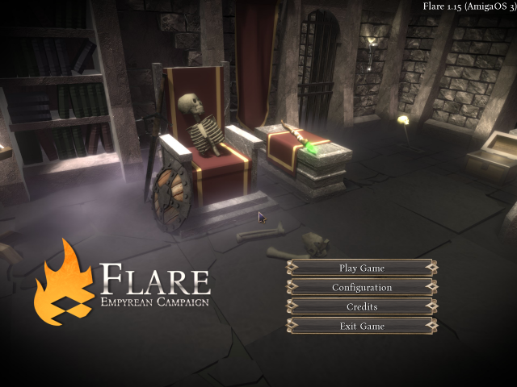
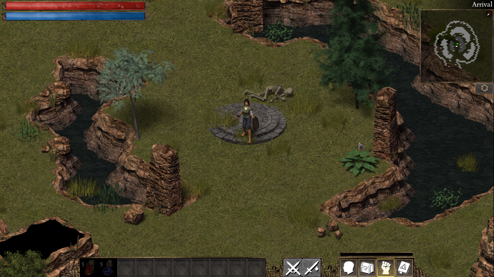
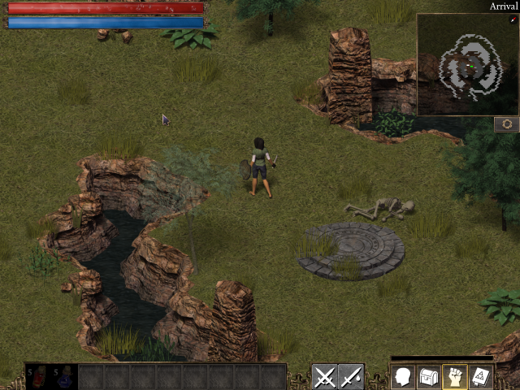

# Flare for the Amiga

Flare (Free/Libre Action Roleplaying Engine) is a single-player 2D action
RPG in the style of the classic hack-and-slash games, and Empyrean
Campaign is its game: leave the city in the sky, explore the lands of the
exiled, fight, loot and grow your hero as a Brute, Scout or Adept.

This is the AmigaOS 3.x port of Flare 1.15 and its Empyrean Campaign, on
OpenGPU's SDL 2, with the game's own free art, music and sounds.

## Controls

| Control             | Does                                          |
|---------------------|-----------------------------------------------|
| Left mouse button   | Walk there, attack, pick up, talk             |
| Right mouse button  | The power in the action bar's right-mouse slot |
| W A S D / arrows    | Walk (without the mouse)                      |
| Q E R F, 1 to 6     | The powers on the action bar                  |
| C, I, P, L          | Character, inventory, powers, log             |
| B                   | Action bar (select a slot)                    |
| Tab                 | Swap equipment sets                           |
| M                   | Minimap mode                                  |
| Esc                 | Close a menu; the pause menu                  |

The keys can be changed under Configuration.

## Requirements

- AmigaOS 3.x, a 68040 or 68060 with an FPU
- An RTG card (or AmigaChrome)
- OpenGPU 0.6 or later (OpenUp installs it): SDL2.module,
  SDL2_image.module, SDL2_mixer.module, SDL2_ttf.module
- About 620 MB of disk

## Running it

Unpack the archive where you keep games, open the Flare drawer and
double-click Flare. The settings (config/) and the saved games
(userdata/) are kept in the drawer.

Building, what was changed for the Amiga and the known limits are in
[AMIGA_PORT.md](AMIGA_PORT.md). Upstream's README is
[README.engine.md](README.engine.md).

## Licences

The engine is GPL 3 or later (COPYING). The game's art, music and data are
CC BY-SA 3.0 (flare-game's LICENSE.txt and CREDITS.txt, in the drawer as
LICENSE-data.txt and CREDITS-data.txt).
